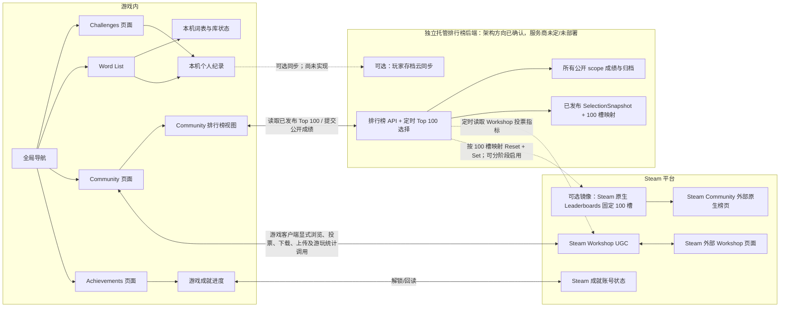
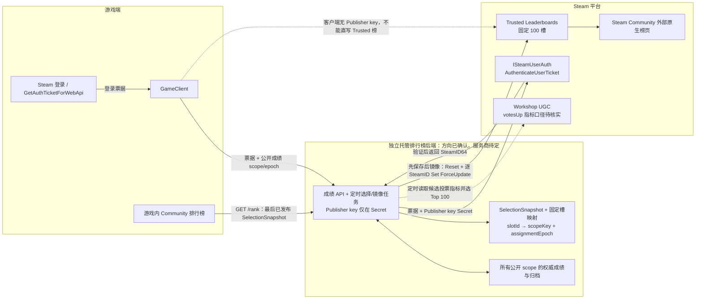

# 社区、词表与排行榜架构概览（WIP）

**状态：** 2026-10-31 WIP。已确认独立托管后端权威保存公开社区 scope 成绩/归档，游戏内榜单与 Steam 原生榜使用同一服务端 Top 100 选择；服务商、指标细节和平台接入仍待定/实现，不表示社区或公开排行榜已经上线。

最新产品决策、讨论顺序和实施 roadmap 汇总在
[`community-v1-discussion-summary.md`](community-v1-discussion-summary.md)。本文继续保存底层架构细节；两文冲突时，以汇总文档的最新结论为准。
独立场景 mockup 的文件位置、当前可观察状态和验收边界见
[`ui-mockup-handoff.md`](ui-mockup-handoff.md)。

详细字段与历史兼容见[社区词表 WIP](community-wordlists-wip.md)和[词表数据模型 WIP](wordlist-data-model-wip.md)。Steam 成就实现状态见[Steam 成就技术规格](steam-achievements-spec.md)。旧的 Supabase 方案[保留作历史记录](communityBuildPlan_260710.md)，不代表当前已选后端。

## 1. 玩家看到的几个独立入口

全局导航的目标文案为 **Challenges、Word List、Community、Achievements**。它们是不同任务入口，不是同一个“社区列表”的四种标签：

- **Challenges**：游戏内置挑战和挑战进度。
- **Word List**：玩家本机可用的词表、收藏和个人成绩；这是当前 mockup 的目标导航文案，`Word Library` 仍留在部分实现中，待验收前统一。
- **Community**：浏览、投票、下载或发布公开词表；举报者本地隐藏、开发者复核与平台审核分属不同状态。
- **Achievements**：游戏成就条件、进度和 Steam 账号解锁状态。它不是 Steam 社区徽章（Badges）或 Inventory 物品页。

词表库每个条目只属于一个折叠分组：

1. **My Lists**：自建、导入或编辑后另存的本地自有词表。
2. **Community Downloads**：下载的社区原版，保持只读并可显示远端作者；直接 Play 的自动下载按产品决策加入 My Lists 并保留社区来源标记。
3. **My Published**：有公开发布绑定的自有词表；元数据更新保留同一库项，玩法内容变化则发布为新列表。

收藏是横跨这三组的单独视图，不会复制条目。搜索、分组折叠、排序、语言和已游玩筛选属于词表库视图状态。排序候选为最近游玩、名称、加入时间、修改时间、词数和个人星级；没有成绩/游玩记录的项目仍排在对应排序末尾。星级和最佳用时只描述本机玩家的个人记录，不是 Workshop 投票数或公开榜名次。

## 2. 界面和数据服务的关系

游戏内 Community 和 Steam 外部 Workshop 页面呈现同一批公开条目，但入口与布局不同。客户端在相应用户动作或游戏事件发生时调用 Workshop 操作：投票、订阅/下载、上传/更新，以及需要的游玩统计。排行榜后端定时读取投票指标并发布最多 100 个活动 scope；具体 UGC 查询字段/口径和刷新周期仍待确认。游戏内和 Steam 榜都读这一份服务端选集，客户端不自行实时查 UGC 并另算 Top 100。

## 3. 词表、个人纪录和发布身份

一个词表条目同时涉及几种互不替代的身份：

| 对象 | 作用 | 是否相同 |
|---|---|---|
| `localListId`（完整本地 UUID） | 标识本机可编辑的词表身份 | 不是 Workshop ID |
| `contentHash` + 规范化版本 | 标识某个可玩内容版本 | 标题、简介、作者、收藏和发布状态不参与哈希 |
| `PublishedFileId` / `remoteItemId` | 标识 Steam 上的公开 Workshop 条目 | 不是本地 UUID，也不是内容版本 |
| 个人纪录键 | 本地玩家资料 + UUID + 内容 hash + 规则 + 模式 | 不是社区榜单条目 |

下载的社区原版保持只读。玩家选择编辑时生成新的自有列表和新 ID，清除下载/发布绑定，不强制继承来源作者署名。玩家发布自己的列表后，原本的库项移动到 **My Published**；标题、简介和封面等元数据更新继续使用同一个库项和远端条目。词语、阶段、语言、拼音或规则内容发生变化时，必须发布为新的自有列表和新 Workshop Item，旧条目及其成绩保持不变。

本机个人纪录按 `localPlayerProfileId + localListId + contentHash + canonicalizationVersion + rulesetId + modeId` 隔离。内容变化后新 hash 对应新的个人记录作用域，旧纪录保留；只改标题或简介不改变作用域。星级和最佳用时是本机显示和排序数据，不会因为浏览、下载或投票自动成为公开分数。尚未发布的私有列表默认没有公开排行榜 scope；所有本地列表可有个人纪录，但只有公开社区 scope 的成绩提交到排行榜后端。

Workshop 上传载荷只带公开词表内容和必要展示元数据，不带本机收藏、个人成绩、路径或账号资料。Steam Workshop 页面显示公开内容与平台社区信息；游戏内列表仍由游戏管理本地 UUID、下载/发布绑定和个人纪录。

## 4. 三种“成就/排行榜/成绩”不能混为一谈

| 数据或页面 | 由谁管理 | 其他入口会不会自动拥有它 |
|---|---|---|
| 本机个人最佳星级/用时 | 游戏本地个人纪录 | 不会自动上传到 Steam 或云端排行榜 |
| Steam 游戏成就 | Steam 账号的 `ISteamUserStats` 状态，游戏成就页读取/呈现进度 | 不是 Steam Badges/Inventory，也不依赖 Workshop 发布 |
| Steam Workshop 投票和条目统计 | Workshop UGC；票数是公开列表进入 Top 100 的候选选择指标 | 不等同于玩家成绩或排行榜分数；查询字段/口径/窗口待定 |
| 独立托管公开排行榜后端 | 保存所有公开 scope 的权威成绩与历史，定时发布 Top 100 选择 | 是后端真值源；私有词表和本地个人纪录不自动上传 |
| 游戏内排行榜 | 查询后端最后一份完整的 `SelectionSnapshot` 和对应成绩 | 与 Steam 原生镜像使用同一 Top 100，不另行查询 UGC 选榜 |
| Steam 原生 Leaderboard | 固定 100 槽，仅镜像当前服务端选中的 scope | 展示 Steam 原生分数/名次；不是所有 scope 的归档源，不反向覆盖后端 |

Steam 成就的本地进度与 Steam 同步状态分别管理。现有实现使用本地成就档案，并通过 Steam adapter 解锁；Steamworks 后台配置、真实账号解锁和重启回读仍需完成验收。成就不需要 Workshop，也不等于玩家云存档。

个人纪录云同步目前只是候选。若以后用 Steam Cloud 同步 JSON/本机文件，它仍只是玩家存档的跨设备副本：Steam Cloud 不会自动把不同玩家的文件合并成可信的全局数据库或排行榜。

## 5. 统一公开排行榜架构（方向已确认；尚待实现）

当前方向是一个权威数据源、两个展示面：独立托管后端保存所有公开社区 scope 的成绩/版本/归档，并定时发布同一份 Top 100 选择；游戏内排行榜与 Steam 原生榜只展示这份选集。服务商、详细计分、UGC 票数口径和 Steam 原生镜像的启用阶段仍待确定；不表示后端已部署。

| 展示面 | 读取的数据 | 名称与历史范围 |
|---|---|---|
| 游戏内排行榜 | 后端 `GET /rank` 返回的最后一份完整 `SelectionSnapshot` 与对应成绩 | 可显示准确的当前词表标题，并显示同一 Top 100 的成绩；后端保留掉出榜 scope 的历史。客户端不自行实时查询 UGC 或选择另一份 Top 100。 |
| Steam Community 原生榜页 | Steam 原生 Leaderboard 中由后端镜像的固定槽分数/名次 | 与游戏共用服务端选择；网页标题使用 App Admin 配置的固定 `Community Name`，不能承诺按当前词表动态改名，也不显示后端完整历史。 |
| 独立托管后端 | 所有公开 scope 的权威成绩、版本、归档及入选快照 | 服务器真值源；私人词表/本地个人纪录不自动上传。Cloudflare Workers + D1 是服务商候选，不是已选或已部署方案。 |

公开 scope 由 `publicListKey + contentHash + canonicalizationVersion + rulesetId + modeId` 确定。Workshop 赞成/反对票是评分与排序信号；Top 100 使用的具体字段、口径、窗口和平票规则仍待核实。举报与投票分离：官方 `ISteamUGC` 文档提供按举报权重排序和举报数统计，但未公布自动隐藏或下架阈值；玩家举报者的即时本地隐藏是游戏功能，公开内容是否隐藏由开发者/Steam 复核决定。

1. 客户端通过 Steamworks 取得 `GetAuthTicketForWebApi` 票据。后端调用 `ISteamUserAuth/AuthenticateUserTicket` 验证票据并取回 SteamID64；Publisher key 只在后端 Secret 中。
2. 公开成绩先按明确 scope 写入后端权威记录。只有已发布社区列表的公开结果进入服务端；本地私有列表不提交，所有列表的个人星级/最佳用时仍保留在本机。
3. 定时任务按 Workshop 投票/`votesUp` 候选指标选出最多 100 个 scope，生成新的 `SelectionSnapshot`，含 `selectionId`、`effectiveAtUtc`、`scopes`、`slots` 和 `state`。期间保存开始时间与 `refreshing` 状态；游戏内只读取最后已完成的 `published` 版本，避免展示半轮数据。
4. 每个 Steam 固定槽映射到一个 scope，并持有单调递增的 `assignmentEpoch`。分数提交携带 scope 和 epoch；后端核实当前映射，旧 epoch 结果不得写到新占用者的槽。scope 掉出 Top 100 时只退出镜像，不删除后端成绩；同 scope 重新入选时用原存档恢复，内容版本不同则使用新 scope。
5. 若启用 Steam 镜像，100 个固定榜预配置 **Writes = Trusted**。后端对每槽调用 `ResetLeaderboard`，再逐 SteamID 调用 `SetLeaderboardScore(ForceUpdate)`。Steam 没有原子批量替换；重填时网页可能短暂显示空榜或部分榜，且 `Community Name` 没有运行时更新 API，固定槽网页标题可能是通用名称。Steam 镜像不作为权威归档源，也不回读覆盖后端记录。

建议分阶段：先制作纯 mockup 并让 UI 依赖可替换的排行榜接口；之后接入独立托管后端，游戏页面从已发布 Top 100 查询；Steam 固定槽镜像可按单独排期启用。Cloudflare Workers + D1 可避免维护常驻 VM，但仍需账号、首次配置/部署、密钥和额度管理；当前只是候选，免费额度与可用性会变化，部署时需重新核对。

- [Steam Leaderboards：Community Name、内部 Name 与社区展示](https://partner.steamgames.com/doc/features/leaderboards)
- [`ISteamLeaderboards`：Reset、Set 与 publisher key 边界](https://partner.steamgames.com/doc/webapi/ISteamLeaderboards)
- [`ISteamUserAuth`：AuthenticateUserTicket](https://partner.steamgames.com/doc/webapi/ISteamUserAuth)
- [Cloudflare Workers Fetch](https://developers.cloudflare.com/workers/runtime-apis/fetch/) 与 [Cron Triggers](https://developers.cloudflare.com/workers/configuration/cron-triggers/)
- [Cloudflare D1 pricing and limits](https://developers.cloudflare.com/d1/platform/pricing/)

## 6. 当前决定和实现状态

| 主题 | 已确定 / 建议 | 当前状态 |
|---|---|---|
| 全局导航与词表库分组 | Challenges、Word List、Community、Achievements 分离；三个词表组互斥，收藏跨组 | 纯内存模型、store、controller、EditMode 测试源码、隔离 Builder 和 `Assets/Scenes/UI-Mockups/WordListHubMockup.unity` 均已落盘。尚未完成 Unity 编辑器/Play Mode 验收或正式场景集成；mockup 不是主游戏可用功能 |
| 编辑/发布身份 | 编辑社区词表另存为新自有 ID；元数据更新沿用原条目，玩法内容变化发布新条目 | 仅 WIP/mockup 行为，未迁移当前存档 |
| Steam Workshop 与审核 | 作为 Steam 平台公开内容、元数据、版本更新、赞踩评分和举报平台 | 真实 Community 查询、投票、上传、下载和游玩统计流程尚未实现；游戏内举报/仅举报者隐藏/开发者复核也未完成。投票不是自动下架；AI 只辅助复核，不自动隐藏或下架 |
| 个人记录 | 本机成绩按内容版本、规则与模式隔离；所有词表都可有个人记录 | 当前项目仍使用 legacy 本地记录格式；新 JSON schema 是 WIP，迁移尚未实施 |
| Steam 成就 | 游戏内条件与 Steam 账号成就分层，已有三项纵向实现 | 本地进度和 Steam adapter 已实现并编译/自动测试；Steamworks 后台与真实账号端到端回读仍需验收 |
| 自有公开排行榜 | Workers + D1 是可讨论的 serverless 候选 | 未选定、未部署、未接入；Cloudflare 不会自动生成 Steam 页面榜单 |
| Steam 原生榜镜像 | 可作为另一条独立可选路线；固定槽可 Reset 后按 SteamID 重填，需 Trusted Writes | API 路径已核实；未接入。Steam 网页标题不随槽位动态改名，Reset/Set 重填非原子 |

## 7. 当前不作出的承诺

- 不承诺社区功能随首发上线，也不承诺任何特定排行榜服务。
- 不把旧 Supabase 方案视为已选方案；也不把 Steam Workshop 当成成绩数据库。
- 不假设 Workshop 暴露了本项目所需的精确“游玩次数”Top 100 指标。
- 不把个人星级、最佳用时、Workshop 赞数和服务器排名显示成同一个分数。
- 不通过 Steam Cloud 同步来模拟全局排行榜。
- 不承诺 Steam 原生镜像页显示完整历史或动态词表标题；固定槽轮换期间可能短暂显示空榜/部分榜，历史以自有后端归档为准。

## 8. 平台资料

- [Steam Workshop 文档](https://partner.steamgames.com/doc/features/workshop?l=english) 与 [Workshop 实施指南](https://partner.steamgames.com/doc/features/workshop/implementation)
- [`ISteamUGC` API](https://partner.steamgames.com/doc/api/ISteamUGC)
- [Steam Leaderboards](https://partner.steamgames.com/doc/features/leaderboards?l=english) 与 [`ISteamUserStats`](https://partner.steamgames.com/doc/api/ISteamUserStats?l=english)
- [Cloudflare Workers](https://developers.cloudflare.com/workers/) 与 [D1](https://developers.cloudflare.com/d1/)
